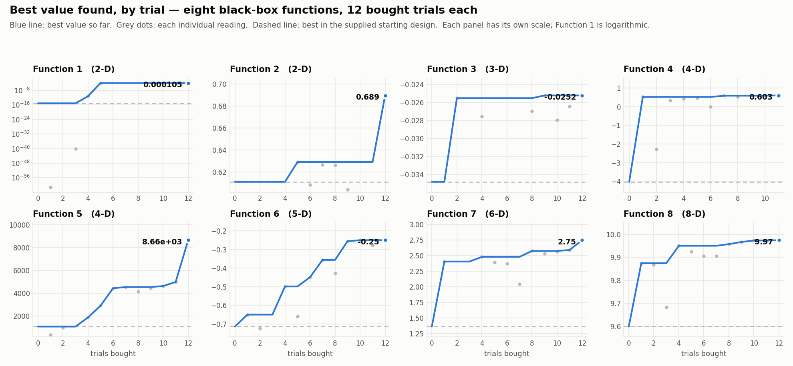

# Bayesian Black-Box Optimisation — Capstone Project

Imperial College Business School, Professional Certificate in Machine Learning and Artificial Intelligence.
Eight unknown functions, thirteen queries each, one week per query.

**Documentation:** [Model card](model_card.md) · [Datasheets (one per function)](datasheets/) · [Weekly log](WEEKLY_LOG.md) · [Final status per function](STATUS.md) · [How it works](HOW_IT_WORKS.md)

---

## NON-TECHNICAL EXPLANATION OF THIS PROJECT

Eight mystery functions. Each takes a handful of numbers and returns one number, and the goal is to find the inputs that make that number as large as possible. There is no formula to inspect: the only way to learn anything is to submit one set of numbers and wait a week for the answer, with thirteen attempts per function. This project builds a best guess of each function's shape — including how confident that guess is — and uses it to decide what is worth measuring next. Every one of the eight improved on its starting point, one by a factor of eight.

---

## DATA

The data set was not found; it was **bought, one query at a time, under a hard budget**. That origin shapes everything about it.

Each function was supplied with a space-filling initial design by the course — between 10 and 40 points depending on dimensionality, as NumPy `.npy` arrays of `float64`. Every subsequent row is a point I chose, submitted, and waited a week for. Those are kept separately, in an append-only CSV per function, so provenance is always recoverable and any model can be rebuilt from scratch at any point in the history.

| Function | Dim | Supplied | Bought | Total | Scenario |
|---|---|---|---|---|---|
| 1 | 2 | 10 | 12 | 22 | Contamination source detection in a radiation field |
| 2 | 2 | 10 | 12 | 22 | Noisy log-likelihood of a mystery ML model |
| 3 | 3 | 15 | 12 | 27 | Drug discovery — adverse reactions from three compounds |
| 4 | 4 | 30 | 11 | 41 | Warehouse placement surrogate, four hyperparameters |
| 5 | 4 | 20 | 12 | 32 | Chemical process yield, four variables |
| 6 | 5 | 20 | 12 | 32 | Cake recipe, five ingredients |
| 7 | 6 | 30 | 12 | 42 | ML model tuning, six hyperparameters |
| 8 | 8 | 40 | 12 | 52 | High-dimensional model tuning, eight parameters |
| | | **175** | **95** | **270** | |

Two hundred and seventy observations in total, and that number is the most important fact about the data set. No amount of careful modelling makes fifty-two points sufficient to describe an eight-dimensional surface, and the whole method is shaped around that scarcity rather than pretending it away.

Function 4 has one fewer bought trial than the others because I submitted its round-3 query to Function 5 by mistake. The gap is left visible rather than tidied away.

The data is small enough to live in the repository in full. There is no external source: the functions belong to the course, the oracle was a weekly submission portal, and what is here is all there will ever be of it. Per-function detail — structure, noise behaviour, sampling evolution, biases and intended uses — is in [`datasheets/`](datasheets/).

**A caution on reuse.** The sampling is adaptive and therefore non-random: early rounds spread out, later rounds cluster tightly around each incumbent. That is the correct allocation for finding a maximum and a biased sample for almost anything else. It should not be used to benchmark optimisers, to characterise the functions globally, or as an unbiased sample for inference.

---

## MODEL

The model is a **Gaussian process surrogate**, refitted from scratch after every returned observation, which predicts both the value of a function at an unseen point and its own uncertainty about that prediction.

A GP was chosen over regression, tree ensembles or an SVM deliberately. Those return a point prediction; on a budget this small the *uncertainty* is the more valuable output, because it is what identifies where a query could still teach you something. A tree ensemble was tested in the model comparison and lost on every function.

Three families compete each round and the winner is whichever predicts held-out points best:

- **Matérn 5/2 with a lengthscale per input** — the flexible default, used on four functions.
- **Additive GP**, a sum of one-dimensional kernels that *forbids* interactions between inputs — a strong assumption, used on two functions where it more than doubled the predictive score.
- **Quadratic trend plus GP residual** — used on the two functions fitted on a log scale, where a peak of their shape is close to an exact quadratic.

The recurring finding, which ran against my expectations, is that **constrained models beat flexible ones under a tight budget**. A flexible model with thirty points spends its flexibility fitting noise; a constrained one spends its few degrees of freedom on structure that is actually there.

What distinguishes the approach is that **the model does not automatically get to choose the next point.** Every round each surrogate is scored by leave-one-out cross-validation, and that score decides how much authority it is given: a model that predicts held-out points well chooses a location freely inside a trust region; a mediocre model may only *rank* about a dozen small candidate steps built around the best point; a model no better than guessing the mean chooses nothing at all, and its queries go to measurement instead. Promotion and demotion both follow the score, re-measured weekly, so a function's tier is a current measurement rather than a standing judgement.

Full details, limitations and trade-offs are in the [model card](model_card.md).

---

## HYPERPARAMETER OPTIMISATION

Two levels of hyperparameter, optimised differently.

**Kernel hyperparameters** — the per-input lengthscales, the signal variance and the noise level — are fitted automatically every round by maximising the marginal likelihood, with ten restarts of the optimiser to avoid poor local solutions. What needed human judgement was not their values but their *bounds*:

- **Lengthscale ceilings.** This is the single most important preprocessing decision in the project. A lengthscale that settles against its upper bound reads as "this input does not matter", and it actually means *the model cannot distinguish weak influence from none at the ceiling you gave it*. Acting on the raw verdict cost two trials on Function 7 before I understood this. Lowering the ceiling until nothing saturates is the test, and on that function it raised the cross-validated score as well as correcting the verdict.
- **Noise bounds.** Fitted freely at first. A deliberate replicate on Function 3 — one whole trial spent measuring rather than optimising — showed the fitted noise was about sixty times larger than reality, which meant real structure had been absorbed into a noise term for six rounds. The bounds were pinned near the measured value thereafter.

**Strategy hyperparameters** — which surrogate family, which acquisition function, the exploration weight, the trust-region radius, the local step size and its floor — were chosen by evidence rather than by search, because each evaluation costs a week and there is no validation set to tune against. The governing rules:

- **Model family** by leave-one-out Q², with a challenger replacing the incumbent only on a margin of about 0.1, since below that the difference is cross-validation noise.
- **Exploration weight** by budget. Optimism is only worth paying for if a later round exists in which to use what it buys, so it was positive early and set to zero from round 10 onward.
- **Step size from measured differences, never from the fitted lengthscales.** On Function 4 the surface moves roughly eighteen units per unit of distance near its optimum while the lengthscales report values near 1.3 — an underestimate of local curvature by more than tenfold. Sizing steps from the model's own hyperparameters made every proposal overshoot; sizing them from "0.012 gained, 0.024 lost" worked immediately.
- **And after any change, confirm the output moved, not just the setting.** On Function 6 a step size was nominally halved several times with no effect at all, because the step was saturating against an internal cap. A change that alters nothing is worse than no change, because it looks like a fix.

Every setting in every notebook carries a dated comment recording the evidence that set it. [`STATUS.md`](STATUS.md) gives the final configuration per function, and leads with a table of which settings are *live* under which proposal mechanism — reading a value that is inert is the easiest way to misunderstand what a function is doing.

---

## RESULTS

| Fn | Dim | From the supplied design | Final | Change |
|---|---|---|---|---|
| 1 | 2 | 7.71e−16 | **1.05167e−4** | ~11 orders of magnitude |
| 2 | 2 | 0.611205 | **0.689468** | +0.078 |
| 3 | 3 | −0.034835 | **−0.025235** | +0.0096 |
| 4 | 4 | −4.0255 | **0.602754** | +4.63 |
| 5 | 4 | 1088.86 | **8662.405** | ×7.95 |
| 6 | 5 | −0.714265 | **−0.249746** | +0.465 |
| 7 | 6 | 1.364968 | **2.748654** | ×2.01 |
| 8 | 8 | 9.598482 | **9.974458** | +0.376 |

**All eight improved.** Three things are worth drawing out.

**The largest gains came from overriding the model, not following it.** On Function 5, five readings along one input rose monotonically with an accelerating log-slope while the surrogate predicted a fall — because a quadratic fitted on a log scale is *structurally obliged* to predict a fall beyond its own vertex. Backing the readings and pushing to the corner of the domain produced the project's biggest result. On Function 1, the largest-magnitude readings were all *negative*: the dominant feature is a trough and the maximum sits on a thin lobe beside it. No acquisition function would have found that, because the model correctly saw a low point and correctly avoided it.

**A high cross-validation score does not mean a model is right where you are about to use it.** Function 8 scored 0.996 and over-predicted its own proposal on seven consecutive rounds — a systematic bias, not noise, that the score could not see, because cross-validation tests interpolation among points the model already holds while every query is an extrapolation to a point it does not. Function 4 scored 0.980 while over-smoothing its own peak more than tenfold. These were the two best-scoring models and the two worst-behaved.

**The clearest mistake was not exploring the axes I never touched.** Three functions were holding most of their remaining value on an input that had never been varied at the incumbent, while I spent round after round refining inputs already bracketed on both sides. Local refinement concentrates effort where feedback already exists, which is exactly where the remaining gain is smallest. A one-variable sweep across every axis, run early, would have cost a few trials and found those gaps nine rounds sooner. It is the single change I would make to the method.

---

## REPOSITORY CONTENTS

| Path | What it is |
|---|---|
| [`BBO_results.ipynb`](BBO_results.ipynb) | **Start here.** Loads every observation, reproduces the results table and the figure above, re-scores all three surrogate families on each function, and walks through the method. |
| [`model_card.md`](model_card.md) | Model card: architecture, performance, limitations, trade-offs, ethical considerations. |
| [`datasheets/`](datasheets/) | One datasheet per function, plus a dataset-level overview. |
| [`bbo_toolkit.py`](bbo_toolkit.py) | Shared implementation: surrogates, acquisition functions, proposal mechanisms, cross-validation. |
| `function_1/` … `function_8/` | Per function: the optimiser notebook, the immutable initial design, and the append-only trial log. |
| `initial_data/` | Untouched duplicate of the supplied initial designs. |
| [`WEEKLY_LOG.md`](WEEKLY_LOG.md) | Dated record of every round — what was submitted, what came back, what changed and why. Newest first. Includes the mistakes. |
| [`STATUS.md`](STATUS.md) | Final configuration per function, and which settings are live under which proposal mechanism. |
| [`HOW_IT_WORKS.md`](HOW_IT_WORKS.md) | Plain-language guide to the code, the weekly routine and every setting. |
| `surrogate_shootout.py` / `.csv` | The model comparison that selected the three surrogate families: eight candidates scored against all eight functions. |
| `GP_surrogate_per_dimension.ipynb` | Surrogate visualisation — fitted mean and uncertainty band along each input dimension. |
| `reference/` | Problem descriptions and the initial exploratory analysis. |
| `archive/` | Superseded notebooks and earlier strategy notes, kept for the record. |

**Reproducing this.** Python 3 with NumPy, SciPy, scikit-learn 1.8.0, pandas and matplotlib. Open [`BBO_results.ipynb`](BBO_results.ipynb) and run it top to bottom, or open any `function_i/F{i}_optimizer.ipynb` to see how a single week's proposal was produced. The random seed is fixed at 0 throughout. One caveat, stated because it is easy to be caught by: kernel hyperparameter fitting is a non-convex optimisation that can settle in different basins on different numerical libraries, so the *procedure* reproduces exactly while an individual proposed point may differ in its later decimals.

---

## CONTACT

Questions and critique welcome — particularly on Function 3, where no surrogate family I tried exceeded a cross-validated score of 0.13 and I would genuinely like to know what I missed.
